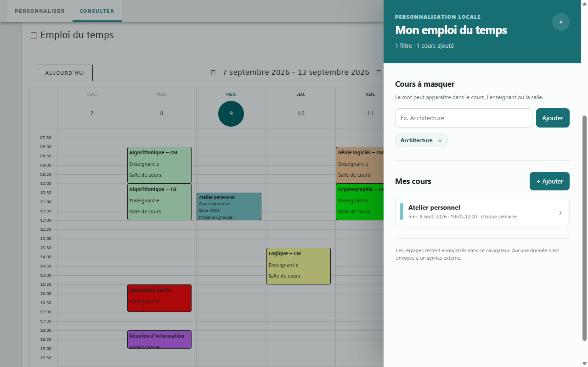

# Unistra Schedule

Une extension de navigateur indépendante, compatible avec Chrome, Brave, Edge et Firefox, pour adapter le calendrier en ligne de l’Université de Strasbourg à son propre emploi du temps.



## Fonctionnalités

- masquer les cours dont le titre, l’enseignant ou la salle contient un mot-clé ;
- ajouter des cours personnels avec date, horaires, enseignant, salle, note et couleur ;
- répéter un cours chaque semaine jusqu’à une date choisie ;
- modifier ou supprimer un cours en cliquant dessus dans le calendrier ;
- conserver les réglages localement dans le navigateur.

L’extension fonctionne uniquement sur `monemploidutemps.unistra.fr` et `monedt.unistra.fr`. Les filtres et les cours personnels sont partagés entre ces deux adresses. Elle ne contient ni suivi d’audience, ni publicité, ni appel vers un service externe.

> Ce projet est indépendant et n’est ni édité, ni approuvé, ni maintenu par l’Université de Strasbourg.

## Installation locale sur Chrome, Brave ou Edge

1. Télécharger ou cloner ce dépôt.
2. Ouvrir `chrome://extensions` dans Chrome, `brave://extensions` dans Brave ou `edge://extensions` dans Edge.
3. Activer le **Mode développeur**.
4. Cliquer sur **Charger l’extension non empaquetée**.
5. Sélectionner le dossier `extension` du dépôt.
6. Ouvrir ou recharger <https://monemploidutemps.unistra.fr/consult/calendar> ou <https://monedt.unistra.fr/consult/calendar>.

Le bouton **Mon EDT** apparaît en bas à droite du calendrier. L’icône dans la barre d’outils ouvre le même panneau.

## Installation temporaire sur Firefox

1. Télécharger ou cloner ce dépôt.
2. Ouvrir `about:debugging#/runtime/this-firefox` dans Firefox.
3. Cliquer sur **Charger un module complémentaire temporaire**.
4. Sélectionner `extension/manifest.json`.
5. Ouvrir ou recharger l’une des deux adresses du calendrier.

Cette installation temporaire est supprimée au redémarrage de Firefox. La version distribuée par Firefox Add-ons est, elle, signée et installée durablement.

## Structure du dépôt

```text
extension/          Code réellement chargé par les navigateurs
  icons/            Icônes utilisées par le navigateur et les stores
store-assets/       Captures et textes destinés aux fiches des stores
scripts/            Validation et création du ZIP publiable
.github/workflows/  Contrôle automatique sur GitHub
```

Le code de l’extension ne nécessite ni compilation ni dépendance JavaScript.

## Vérifier et empaqueter

Avec Node.js 22 ou une version ultérieure :

```powershell
node --check extension/content.js
node --check extension/background.js
node scripts/validate-manifest.mjs
npx.cmd --yes web-ext@10.6.0 lint --source-dir extension --output=json --boring |
  node scripts/check-firefox-report.mjs
```

Sous Windows, le script suivant lance les contrôles locaux et crée le ZIP commun attendu par le Chrome Web Store et Firefox Add-ons :

```powershell
powershell -ExecutionPolicy Bypass -File scripts/package.ps1
```

L’archive est créée dans `dist/`. Son `manifest.json` se trouve directement à la racine du ZIP. Le même fichier peut être envoyé aux deux stores.

## Contribuer

Le [code source](https://github.com/orpheusbauer/UnistraSchedule) est public. Les corrections et propositions sont bienvenues : consultez [CONTRIBUTING.md](CONTRIBUTING.md) avant d’ouvrir une pull request, ou utilisez les [issues GitHub](https://github.com/orpheusbauer/UnistraSchedule/issues) pour signaler un problème et suggérer une amélioration.

Pour préparer une publication, suivez le [guide de mise en version](docs/RELEASING.md), puis le [guide Chrome Web Store](docs/CHROME_WEB_STORE.md) ou le [guide Firefox Add-ons](docs/FIREFOX_ADDONS.md). Les pratiques relatives aux données sont détaillées dans la [politique de confidentialité](PRIVACY.md).

## Licence

Ce projet est distribué sous licence [MIT](LICENSE).
